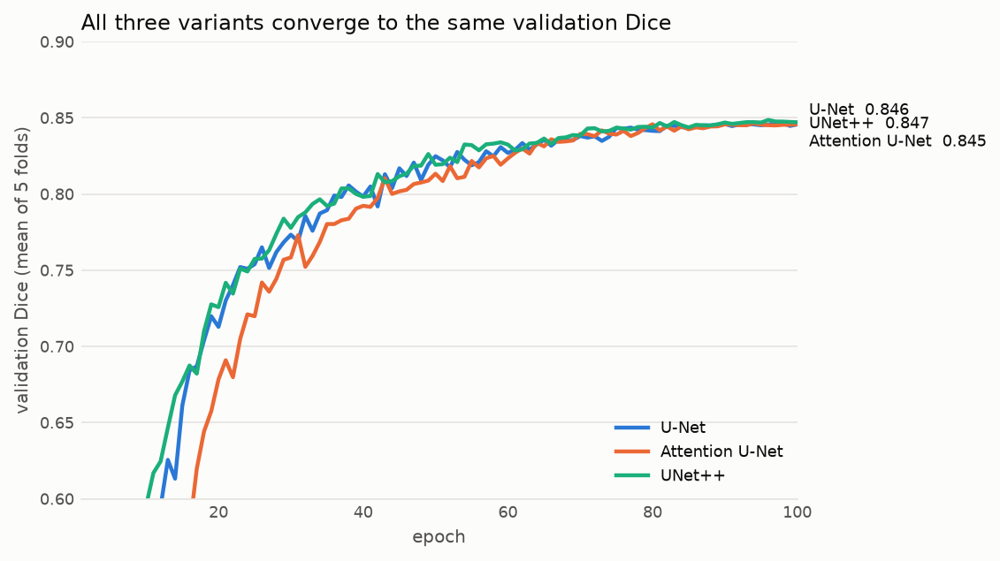
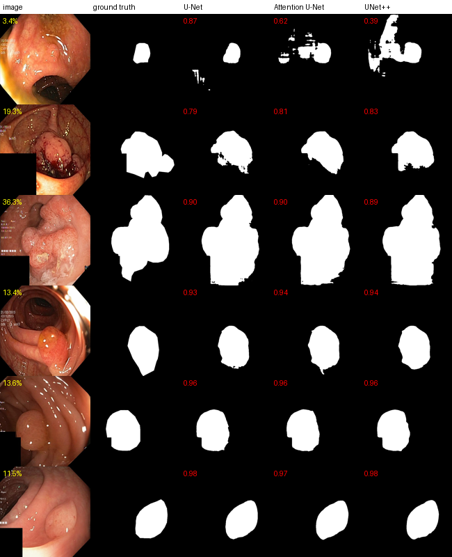
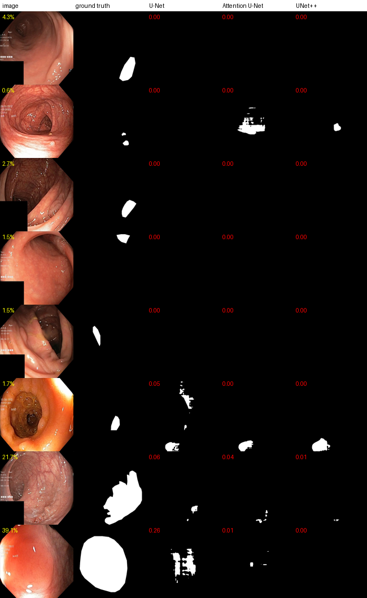

# U-Net vs Attention U-Net vs UNet++ on Kvasir-SEG

A controlled comparison of three U-Net architectures, implemented from their papers in PyTorch and trained under identical conditions with 5-fold cross-validation for polyp segmentation in colonoscopy images.

**Result: all three variants perform about the same.** Over 1,000 test images, mean Dice is 0.850 (U-Net), 0.843 (Attention U-Net) and 0.847 (UNet++). The largest gap between any two models is 0.007 Dice, which is smaller than the difference between folds. Plain U-Net comes out slightly ahead, trains fastest and is the simplest of the three.

<p align="center"></p>

---

## Contents
- [Problem statement](#problem-statement)
- [Models](#models)
- [Dataset](#dataset)
- [Method](#method)
- [Results](#results)
- [Error analysis](#error-analysis)
- [Findings](#findings)
- [Limitations](#limitations)
- [Reproducing](#reproducing)
- [Repository layout](#repository-layout)
- [References](#references)
- [License](#license)

## Problem statement

Many papers propose a U-Net variant and report that it beats U-Net. Those comparisons often use different training budgets, preprocessing or data splits, and report a single number from a single split. This project asks a narrower question:

> If U-Net, Attention U-Net and UNet++ are trained with **the same data, splits, augmentation, loss, optimiser, epoch budget and seed**, does either newer architecture actually segment better, and is the difference larger than the noise from the train/test split?

The task is binary segmentation of colorectal polyps in colonoscopy frames (Kvasir-SEG). The aim is to test the implementations and the comparison method, not to build a clinical tool.

## Models

All three are in [`models/UNet_models.py`](models/UNet_models.py). They share the same building block, depth (4 down-samplings) and channel progression (32 → 64 → 128 → 256 → 512), so the only thing that changes is how the decoder uses the encoder's features.

| Model | Paper | What it changes | Parameters (trained config) |
|---|---|---|---|
| **U-Net** (`FlexibleUNet`) | Ronneberger et al., 2015 | Encoder–decoder with skip connections that concatenate encoder features into the decoder | 7.76 M |
| **Attention U-Net** (`AttentionUNet`) | Oktay et al., 2018 | Adds an attention gate on each skip connection. The gate is guided by the coarser decoder features and down-weights skip features that aren't relevant before they're concatenated | 8.02 M |
| **UNet++** (`FlexibleUNetPP`) | Zhou et al., 2018 | Replaces each plain skip connection with nested, densely connected convolution blocks, gradually closing the semantic gap between encoder and decoder. Optional deep supervision (not used here) | 9.05 M |

**Implementation notes**
- **Shared block:** `DoubleConv` is (3×3 conv → BatchNorm → ReLU) × 2. Two deliberate differences from the original U-Net paper: padding of 1 keeps the image size unchanged instead of cropping the skips, and BatchNorm is added. A `ResidualBlock` (He et al., 2016) can be swapped in through the `block=` argument.
- **Attention gate:** implements Oktay et al.'s equations 1–2, α = σ(ψ(ReLU(W<sub>x</sub>x + W<sub>g</sub>g + b<sub>g</sub>)) + b<sub>ψ</sub>). The skip features x are downsampled to the gating signal's resolution with a strided 2×2 convolution, as in the authors' code, and α is upsampled back.
- **UNet++:** node X<sup>i,j</sup> takes all earlier same-level nodes plus an upsampled X<sup>i+1,j−1</sup>, so its input has c<sub>i</sub>·(j+1) channels.
- **Checked against the papers:** with the UNet++ paper's settings (base 32, convolutions with bias, no BatchNorm), the code gives exactly the paper's reported parameter counts, **7.76 M for U-Net and 9.04 M for UNet++** (Zhou et al., Table 2). See [`tests/test_models.py`](tests/test_models.py), which also checks the attention gate against its equations written out by hand and confirms each model can memorise a single batch.

## Dataset

[**Kvasir-SEG**](https://datasets.simula.no/kvasir-seg/) (Jha et al., 2020): 1,000 colonoscopy images with polyp masks drawn by hand and checked by an experienced gastroenterologist.

**Audit before training** ([`scripts/audit_kvasir.py`](scripts/audit_kvasir.py)):

| Property | Finding |
|---|---|
| Pairing | 1,000 images, 1,000 masks, all matched; image and mask sizes always agree |
| Image size | 333 different sizes, 332×352 to 1920×1072 (median about 620×530) → resized to 256×256 for training |
| Masks | JPEG, but values are only near 0 or near 255; thresholding at 128 is safe; no empty masks |
| Polyp size | 0.5 % to 81 % of the image, median 11 % |
| Polyps per image | 819 have one, 164 have two, 17 have three or more |
| Near-duplicates | At least 2 exact duplicates stored under different IDs, plus several frames of the same polyp from the same video |

**Leakage-aware split** ([`scripts/make_splits.py`](scripts/make_splits.py) → [`splits/kvasir_5fold.json`](splits/kvasir_5fold.json))
- **Grouping:** images are linked when their ResNet-50 (ImageNet) features have cosine similarity ≥ 0.89. That cutoff was chosen by looking at sample pairs: pairs above 0.90 were almost always the same polyp. Linked images form 959 groups, and **a group never spans two folds**.
- **Folds:** 5 folds of 192–205 images, balanced by polyp size. Fold *k* is the test set, fold *k*+1 is validation and the other three train (about 600 / 200 / 200 images).

## Method

Every model and fold uses the same settings ([`train.py`](train.py)):

| Setting | Value |
|---|---|
| Input | 256×256 RGB, ImageNet normalisation |
| Augmentation | Horizontal and vertical flips, 90° rotations, affine (scale 0.8–1.2, shift ±10 %, rotation ±30°), mild colour changes |
| Loss | Binary cross-entropy + soft Dice (Dice computed per image) |
| Optimiser | AdamW, learning rate 3e-4, weight decay 1e-4, cosine decay over 100 epochs, batch size 8 |
| Model selection | Checkpoint with the best validation Dice (no early stopping, so every model gets the same budget) |
| Precision / seed | fp32, seed 0 |
| Hardware | Fold 0 on an Apple M1 (MPS); folds 1–4 on Kaggle T4 GPUs (CUDA), one fold per GPU |

**Evaluation** ([`scripts/evaluate_runs.py`](scripts/evaluate_runs.py)): each fold's best checkpoint predicts its test images. The logits are upsampled to the image's **original resolution** before scoring, so every one of the 1,000 images is scored exactly once.
- **Dice and IoU.**
- **HD95:** the 95th-percentile distance between the predicted and true boundaries, as a % of the image diagonal (images have no physical pixel size). An empty prediction scores 100 %, the worst possible.
- **NSD:** normalised surface Dice, the share of boundary that lies within a tolerance of 1 % of the image diagonal (about 8 px).

**Statistics** ([`scripts/analyze_results.py`](scripts/analyze_results.py)): 95 % confidence intervals use a **cluster bootstrap over the near-duplicate groups** (5,000 resamples), so look-alike images aren't counted as independent evidence. Models are compared image by image (paired) with Wilcoxon signed-rank tests, using a Bonferroni-corrected threshold of p < 0.0083 for 6 tests.

## Results

### Overall (1,000 test images, 5 folds)

| Model | Dice ↑ | IoU ↑ | NSD ↑ | HD95, % diag (median) ↓ | Median Dice | Images with Dice < 0.5 |
|---|---|---|---|---|---|---|
| **U-Net** | **0.850** [0.838, 0.861] | **0.774** [0.760, 0.788] | **0.696** [0.680, 0.711] | **5.02** [4.24, 5.84] | 0.926 | **63** |
| Attention U-Net | 0.843 [0.831, 0.855] | 0.766 [0.752, 0.780] | 0.686 [0.670, 0.702] | 6.02 [5.02, 6.89] | 0.926 | 73 |
| UNet++ | 0.847 [0.836, 0.859] | 0.770 [0.756, 0.783] | 0.694 [0.678, 0.709] | 5.78 [4.84, 6.89] | 0.923 | 67 |

### Per fold (mean test Dice)

| Fold | U-Net | Attention U-Net | UNet++ |
|---|---|---|---|
| 0 | **0.835** | 0.834 | 0.833 |
| 1 | **0.871** | 0.871 | 0.868 |
| 2 | 0.860 | 0.849 | **0.862** |
| 3 | **0.856** | 0.838 | 0.841 |
| 4 | 0.828 | 0.822 | **0.834** |
| mean ± sd | **0.850 ± 0.018** | 0.843 ± 0.018 | 0.847 ± 0.016 |

### Paired comparisons

| Comparison | Metric | Mean difference | 95 % CI | Wilcoxon p | Folds where A wins |
|---|---|---|---|---|---|
| U-Net − Attention U-Net | Dice | +0.0070 | [+0.0011, +0.0134] | 0.019 | 5 / 5 |
| U-Net − Attention U-Net | NSD | +0.0099 | [+0.0019, +0.0180] | 0.039 | 4 / 5 |
| U-Net − UNet++ | Dice | +0.0026 | [−0.0033, +0.0086] | 0.61 | 3 / 5 |
| U-Net − UNet++ | NSD | +0.0022 | [−0.0054, +0.0099] | 0.70 | 3 / 5 |
| Attention U-Net − UNet++ | Dice | −0.0044 | [−0.0110, +0.0021] | 0.91 | 2 / 5 |
| Attention U-Net − UNet++ | NSD | −0.0077 | [−0.0159, +0.0004] | 0.27 | 1 / 5 |

None of the differences pass the corrected threshold (p < 0.0083).

### Cost

| Model | Training time per fold, T4 GPU | Same on Apple M1 | Peak GPU memory on T4 (batch 8) |
|---|---|---|---|
| U-Net | 25 min | 1 h 53 min | 5.4 GB |
| Attention U-Net | 27 min | 2 h 26 min | 5.4 GB |
| UNet++ | 64 min | 5 h 07 min | 11.8 GB |

### Comparison with published numbers

PraNet (Fan et al., 2020) reports Kvasir-SEG Dice of 0.818 for U-Net and 0.821 for UNet++, using a different split (900/100), resolution and training recipe. The numbers here are in the same range and slightly higher, which supports the implementations and pipeline being sound. Exact equality isn't expected.

## Error analysis

### What typical output looks like
Images at the 10th, 26th, 42nd, 58th, 74th and 90th percentiles of mean Dice. Red is each model's Dice and yellow is the polyp's share of the image.

<p align="center"></p>

From the median upward, all three models produce nearly identical masks (Dice 0.93–0.98). Differences show up only on harder images: in the top row (10th percentile), Attention U-Net and UNet++ add false patches around a small polyp that U-Net avoids.

### Worst cases
The 8 images with the lowest Dice averaged over the three models:

<p align="center"></p>

- **Shared failures.** 46 images score below 0.5 for **all three** models, and 92 for at least one. Because the failures are mostly shared, they come from the images, not from any one architecture.
- **Small, flat polyps** (0.6–4 % of the image) are the most common failure. They're low-contrast and only a few dozen pixels across at 256 px, and small polyps account for 32 of the 62 images where the three models' average Dice is below 0.5.
- **Close-up flat lesions** that fill much of the frame (22 % and 39 % in the last two rows) have almost no visible edge. All three models miss nearly all of them.
- **Plausible mistakes, not bad labels.** In one image (row 6) the models segment a different bump from the annotated one. None of the worst cases looked like a labelling error.

### Dice by polyp size

| Polyp size (share of image) | n | U-Net | Attention U-Net | UNet++ |
|---|---|---|---|---|
| Small (0.5–7.7 %) | 334 | 0.820 | 0.804 | 0.819 |
| Medium (7.7–16.7 %) | 333 | 0.886 | 0.880 | 0.887 |
| Large (16.8–81.2 %) | 333 | 0.844 | 0.846 | 0.837 |

Large polyps score *lower* than medium ones for two reasons:
- **The image edge cuts them off.** 54 % of large polyps touch the image border, and those score 0.81 vs 0.88 for the rest. Where a polyp runs out of frame, its outline is partly guesswork for the annotator and the model alike.
- **More complete misses:** 19 large polyps score below 0.5, vs 11 medium ones. These are the close-up flat lesions above.

## Findings

1. **The newer architectures didn't improve on U-Net in this setting.** With identical training, the best (U-Net) and worst (Attention U-Net) are 0.007 Dice apart. U-Net beats Attention U-Net in all 5 folds, but the gap isn't significant after correcting for multiple comparisons. U-Net and UNet++ are statistically indistinguishable.
2. **The split matters more than the architecture.** The fold-to-fold spread (sd ≈ 0.017) is 2–7 times the gap between any two models (0.003–0.007), so a single-split comparison of these models would mostly measure which images landed in the test set.
3. **Extra complexity costs compute without adding accuracy.** UNet++ takes 2.5× U-Net's training time and twice the memory for no gain, and attention gates add about 10 % training time for a small loss.
4. **Failures are shared and driven by the data.** The hard images (small or flat polyps, polyps cut off by the frame) defeat all three models. That points to input resolution and data, not decoder design, as the next thing to change.
5. **The checks passed.** The paper's parameter counts are matched exactly, scores land in the published range, and validation curves flatten (validation Dice varies by at most ±0.002 over the last 10 epochs of every run). The gap between training and validation loss is 0.03–0.11 on folds 0–3 and 0.17–0.21 on fold 4, the hardest fold, so there is some overfitting but no runaway.

## Limitations

- **One dataset, one resolution, one training recipe.** Attention gates and nested skips may help more at higher resolution, on larger datasets, on 3D data or on organs with more varied shapes. The finding is "no improvement under these conditions", not "never helps".
- **No outside test yet.** All test images come from Kvasir-SEG. A cross-dataset test (e.g. CVC-ClinicDB) is the planned next step.
- **One seed per model and fold.** Variation from training randomness isn't separated from variation from the split.
- **Mixed hardware.** Fold 0 ran on Apple MPS and folds 1–4 on CUDA. All models within a fold share hardware, so comparisons stay paired. Re-scoring CUDA-trained checkpoints on MPS changed Dice by more than 0.01 on 13–21 of 800 images per model. All reported numbers come from one re-scoring pass ([`scripts/evaluate_runs.py`](scripts/evaluate_runs.py)).
- **No strong baseline.** nnU-Net, the field's standard self-configuring baseline, wasn't run.
- **Near-duplicate grouping is approximate.** It uses image features and a hand-chosen cutoff, and Kvasir-SEG provides no patient IDs.

## Reproducing

**Setup** (Python 3.13; tested on macOS with Apple silicon and on Kaggle with CUDA):
```bash
python -m venv UNET.venv && source UNET.venv/bin/activate
pip install -r requirements.txt
# Kvasir-SEG: download https://datasets.simula.no/downloads/kvasir-seg.zip and unzip to ./Kvasir-SEG
python -m pytest                       # 39 tests: models, metrics, split integrity, augmentation alignment
```

**Data audit and splits** (the split file is already committed, so this step is optional):
```bash
python scripts/audit_kvasir.py
python scripts/make_splits.py          # writes splits/kvasir_5fold.json
```

**Training**:
```bash
python train.py --model unet --fold 0                       # one model, one fold
python train.py --model unetpp --fold 0 --benchmark 10      # time 10 batches first
python scripts/run_folds.py --folds 0 1 2 3 4               # all models, all folds, one device
python scripts/run_folds.py --folds 1 2 3 4 --gpus 0 1      # spread folds across GPUs
```
Runs that already have a `summary.json` are skipped, so an interrupted job can simply be restarted. Outputs go to `runs/kvasir/<model>_double_conv/fold<k>/`: `config.json`, `best.pth`, `history.csv`, `test_metrics.csv`, `summary.json` and TensorBoard logs.

**On Kaggle** (2× T4; folds 1–4 took 3 h 55 min): run `scripts/package_for_kaggle.sh` and upload `dist/unet-code.zip` as a Kaggle dataset. Then import [`kaggle/kvasir_folds.ipynb`](kaggle/kvasir_folds.ipynb), attach the dataset, set *GPU T4 x2* and *Internet on*, and choose *Save & Run All*. [`kaggle/setup_kaggle.py`](kaggle/setup_kaggle.py) downloads Kvasir-SEG and checks it file by file against the copy used here.

**Evaluation, statistics and figures**:
```bash
python scripts/evaluate_runs.py        # per-image Dice/IoU/HD95/NSD and predicted masks
python scripts/analyze_results.py      # tables in runs/kvasir/analysis/
python scripts/make_figures.py         # figures in assets/
```

## Repository layout

```
models/UNet_models.py      U-Net, Attention U-Net, UNet++, DoubleConv, ResidualBlock, AttentionGate
utils/data.py              Kvasir-SEG dataset, fold loading, augmentations
utils/losses.py            BCE + soft Dice loss, per-image Dice/IoU
utils/utils.py             training loop, validation, test at original resolution
train.py                   train + test one model on one fold
scripts/                   data audit, split creation, multi-fold runner, evaluation, statistics, figures
splits/kvasir_5fold.json   the fixed, leakage-aware 5-fold split (with near-duplicate groups)
kaggle/                    Kaggle notebook + setup (data download and checksum)
tests/                     model and pipeline tests
assets/                    figures used in this README
```

## References

- O. Ronneberger, P. Fischer, T. Brox. *U-Net: Convolutional Networks for Biomedical Image Segmentation.* MICCAI 2015.
- O. Oktay et al. *Attention U-Net: Learning Where to Look for the Pancreas.* MIDL 2018.
- Z. Zhou, M. M. Rahman Siddiquee, N. Tajbakhsh, J. Liang. *UNet++: A Nested U-Net Architecture for Medical Image Segmentation.* DLMIA 2018.
- K. He, X. Zhang, S. Ren, J. Sun. *Deep Residual Learning for Image Recognition.* CVPR 2016.
- D. Jha et al. *Kvasir-SEG: A Segmented Polyp Dataset.* MultiMedia Modeling (MMM) 2020.
- D.-P. Fan et al. *PraNet: Parallel Reverse Attention Network for Polyp Segmentation.* MICCAI 2020.

## License

The code is released under the [MIT License](LICENSE).

**Dataset terms:** Kvasir-SEG isn't redistributed here. Download it from the [official page](https://datasets.simula.no/kvasir-seg/), follow its terms of use, and cite Jha et al. (2020) if you use it.
